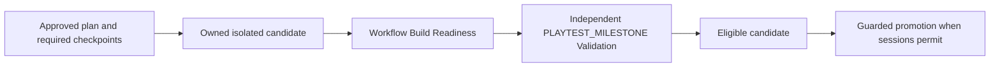

# Phase 6 evolution, playtest and hardening design

The starting integrated main is `32397d2bc0d02c8e77b5c6e09ca7e83f04995af0`,
tree `cad09ba80f7a6f67e81956e70b289bffd14d21ad`. Phase 5 integration and
closure are complete. Its actual merge CI passed 529 tests on Windows Python
3.12.10 and 527 on Ubuntu 3.12.16, with two Windows-only skips. Those observations
remain baseline evidence, not Phase 6 test results.

This design is recorded before implementation. Phase 6 ends in a separately
reviewed PR; it does not authorize its merge. Package 0.1.0, wire schema 1.0,
MPL-2.0, the five Commandments, six Engines and eight contract types remain.

## Ownership and boundaries

| Existing owner | New operational responsibility |
| --- | --- |
| Standard and Adapter Manager | Packaged policy/schema, installed initialization, equivalent managed instructions and honest native capabilities. |
| Project Manager | Explicit advisory assistance, delivered-version review, human product decisions and negotiation of real content changes. |
| Workflow | Version evolution coordination, cumulative build materialization/readiness, promotion, sessions, feedback routing and safe retention. |
| Validation | Independently reviewed methods and exact-candidate scoped runs/results, including playtest and Product gates. |
| Report | Coherent lifecycle projections, immutable history and normal NOT_REVIEWED reports; no audit, promotion or acceptance authority. |
| Shared persistence | Verified v5-to-v6 migration, immutable origins, guarded current state, events and recoverable effects. This is not another Engine or contract. |

Existing Kernel, PM revision/PRR, Workflow reconciliation, runner, process
containment, Validation and Report APIs remain the publication/execution paths.
No new dependency, mandatory container, distributed coordinator or GUI is needed.

## Installed journeys

Initialization uses packaged copies of the approved Standard and schema, explicit
validated configuration and `AdapterManager.prepare`. Existing managed-block
precedence, duplicate/tamper detection and unrelated user content are preserved.
Initialization cannot create contract approval. Explicit capability and PM advice
commands perform bounded discovery/work only when requested; status, show, history,
help and review do not silently launch paid/native assistance.

CLI families cover delivered versions, selective evolution, builds/readiness,
scoped Validation, promotion, sessions, feedback/triage, retention preview/apply
and inspected recovery. Routine operation needs no hand-authored contract JSON
or internal SQL edits. Exact final names are implementation details documented
with the actual commands.

## Operational identity and storage

SQLite advances from v5 to v6 through the existing inspected-backup migration
path. The migration retains the old 20 tables and their original rows, document
bytes, receipts, order and durable identifiers. Fresh stores and every supported
old version take the same verified forward path; failure rolls back new SQL while
retaining its inspected source backup.

Three operational tables suffice:

- `lc_records`: a closed kind set VERSION, EVOLUTION, BUILD, SESSION, FEEDBACK,
  REVIEW and OPERATION; stable record/project/logical key, state, CAS version,
  immutable origin and hash, mutable snapshot and hash, creation/update times.
- `lc_projects`: one project row with IPE enabled flag, stable unique tracker ID,
  active and pending build pointers, CAS version and timestamps. Same-project
  foreign keys and BUILD-kind guards constrain pointers.
- `lc_events`: ordered append-only project/entity facts, actor, event time and
  complete post-state/snapshot/hash. Project-pointer events retain full post-state.

This reuses the repository snapshot/CAS pattern and avoids duplicated tables for
identical storage mechanics. Service-specific closed state/origin validation is
mandatory. The operational kind set is not an extension of ContractType. Immutable
origin/identity bindings and append-only events have SQL guards. Logical keys are
unique within kind/project when present. Reads validate hashes and stay pure.

`LifecycleRepository` shares the existing Store transaction when supplied a
connection. It exposes create/get/find/list/update, explicit project creation,
private guarded project-pointer updates and event reads. Update requires the exact
previous version and increments it once. Every write records its full post-state.
This permits atomic session/promotion/tracker transitions and exact historical
Report reconstruction without backdating current mutable rows.

Delivered versions identify exact contracts, candidate/package/configuration,
documentation and Product Validation. Version IDs, content versions, Project
revisions, evolution requests, builds, operations, sessions and runs stay distinct.
Incremental evolution preserves project_id. Unchanged obligations permit bug
repair without a gratuitous Project revision. Changed product decisions use PM;
changed binding technologies/interfaces/milestones require their real HUMAN
decision. Existing reconciliation derives affected/transitive work and preserves
compatible attempts with their original evidence rather than relabelling them.

## Sealed builds and non-circular gates

Checkpoint completion, readiness and playtest Validation are distinct. A plan
that requires a candidate's own future playtest result before completing its
prerequisite checkpoints is diagnosed as circular; no mandatory gate is dropped
and no checkpoint is marked complete to break that cycle.

A build origin anchors approved source refs, cumulative milestone/checkpoint
closure, sealed source/package/config/tool/recipe inventory and manifest digest.
Physical copies have no writable aliases to development or daily data. Source
copy/hash and command execution occur before the short writer reservation, with
fresh source/metadata guards around durable transitions. Existing limits and
process containment bound files, bytes, commands and cancellation.

The build identity bridge adds a build ID only after verifying its trusted
manifest and actual candidate bytes. Validation observes that same complete
identity at initial capture, every repeated guard, freeze/recovery and publication.
Raw non-build candidate behavior remains unchanged. A caller marker, old VRC or
shared Git commit cannot establish a new build identity.

Availability/promotion rechecks every applicable exact active plan, complete
candidate, latest run/result and required proof. A newer unfinished, interrupted,
blocked or inadmissible run prevents falling back to an older pass. A playtest
pass never certifies the whole Product. Promotion cannot regress cumulative scope;
same-milestone repair needs fresh admissible proof.

## Promotion, sessions and feedback

At most one build is active and one stable tracker exists for an IPE project.
Promotion and the tracker target change in one guarded transaction. An eligible
successor can wait while sessions pin the old build. A different pending request
must conflict or explicitly record supersession. Readiness notifications are
durable local events/status; they do not launch a test or send external messages.

Session origin pins the exact build/identity and isolated data. A voluntary switch
creates a successor session, preserving the old origin; the minimum safe policy
requires all old-build pins to permit transition. Agent disappearance or lease
expiry never proves a playtest stopped. Process uncertainty retains pins until
actual process/effect inspection can justify recovery; no reused PID is killed.

Feedback has immutable build/milestone/code/time/content/session and observer
origin. Treatment is audited state, with bugs routed to Workflow/Validation and
new requirements to PM. Tracker movement does not move or resolve old feedback.
Synthetic/operator observations are labelled; optional owner participation and
Product Acceptance Review are not new technical gates.

## Human product review

PM owns the review journey, but exact accepted/reserved ERC publication still
uses Kernel publisher REPORT with the trusted HUMAN verifier. A review derives a
separate frozen candidate from an ordinary source-backed report and exact delivered
version; the normal Report draft/manifest is never mutated into human consent.
The receipt's immutable OPERATION origin binds document/ref/hash, actor, version
and expiry after the foreground challenge succeeds. Kernel publication, receipt
consumption and review completion share one writer. Stale/replayed/changed receipts
fail. Ordinary generated reports remain NOT_REVIEWED.

## Recovery, retention and reporting

Durable operation IDs, exact request hashes, CAS/fencing and inspected external
effects cover staging, sealing, readiness, validation, promotion, sessions, review
and delivery. Repeating a completed operation reconciles its result. SQLite,
filesystem, Git and native execution are separate failure boundaries.

Retention previews only owned targets. It protects active/pending/pinned builds,
delivered-version payloads and required evidence, keeps historical metadata and
normally a rollback candidate, and reports pressure when no safe deletion exists.
Actual deletion demonstrations use isolated test-owned artifacts only. Local OS
permissions and managed workspaces are not a hostile-code sandbox.

Report explicitly captures the three new tables in its pinned read snapshot.
Immutable origins plus cutoff-bound complete post-state events reconstruct
historical records and project pointers. Current eligibility, past technical facts,
delivery, availability, feedback and exact human decisions remain separate.

## Verification and delivery dependencies

1. Reconcile baseline and record this design/gap matrix.
2. Implement shared v6 repository/migration in one ownership lane; bootstrap/PM,
   build/Validation and playtest/feedback services use that common API.
3. Integrate delivered versions/selective evolution and Report projections/CLI.
4. Exercise populated-v5 migration, failures, races, recovery, authority and exact
   identity negatives; install actual wheels and run real CLI journeys.
5. Prepare one coherent real-pilot milestone proposal and its exact authority
   review. Preserve the daily app/data and earlier proofs; use isolated copies.
6. Demonstrate two meaningful cumulative candidate states, failure/recovery,
   session-safe promotion and actual generated reports; review independently.
7. Verify final-head Windows/Ubuntu CI, documentation and Graphify, then deliver
   the separately reviewed PR without merging it.

Live native interoperability is mandatory. Existing Codex discovery succeeded;
the owner reports having free Claude chat and no Claude Code. Therefore the live
Claude Code task remains an explicit missing required proof. Finish independent
work without buying access, substituting mocks or declaring the full Core/PRD
complete. Any delivered PR must retain an incomplete/draft status while a mandatory
criterion remains unverified. Optional human product acceptance remains separate.
